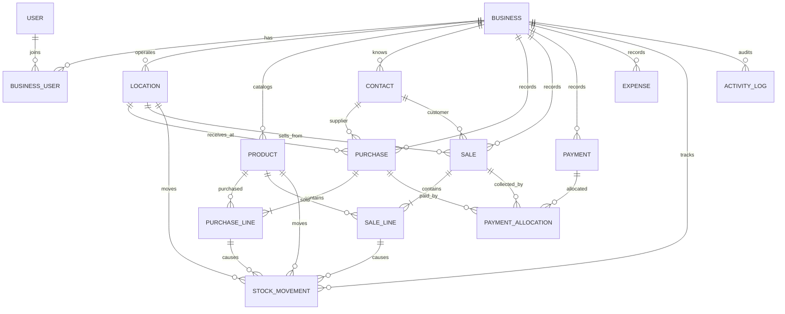

# Dealership SaaS: Core Database Schema

**Status:** Initial implementation blueprint  
**Scope:** Shared dealership operations: tenants, users, locations, catalog, purchasing, sales, payments, expenses, stock, and audit history.

## 1. Design decisions

- Each dealership account is a tenant (`Business`). Every operational record belongs to exactly one business.
- A business gets a default location. Additional branches or warehouses are optional.
- Stock is represented by an immutable movement ledger; on-hand quantities can be calculated from movements and optionally cached in a balance table.
- Purchases and sales use header and line tables. A completed document is corrected through void/reversal records, not by silently rewriting its history.
- Payments are separate records so one payment can be allocated across one or more documents, including partial payments.
- Contacts can be customers, suppliers, or both.
- Monetary values use fixed decimal precision and each business has a configured currency (default BDT).

## 2. Entity relationship map

## 3. Tables

Types below are conceptual; Django implementations should use `DecimalField` for money/quantity and foreign keys with explicit deletion behavior.

### Identity and tenancy

#### `Business`

- `id` (UUID, primary key)
- `name`
- `legal_name` (nullable)
- `phone`, `email`, `address` (nullable)
- `currency_code` (3-character ISO code; default `BDT`)
- `timezone` (default `Asia/Dhaka`)
- `is_active`
- `created_at`, `updated_at`

#### `BusinessUser`

Membership joining Django `User` to a business. Do not assume one login can belong to only one business.

- `id`
- `business_id` → `Business`
- `user_id` → Django `User`
- `role` (`OWNER`, `MANAGER`, `SALES`, `STOCK`, `ACCOUNTS`)
- `is_active`
- `created_at`
- Unique constraint: (`business_id`, `user_id`)

#### `Location`

- `id`
- `business_id` → `Business`
- `name`
- `code`
- `kind` (`BRANCH`, `WAREHOUSE`, `BOTH`)
- `address` (nullable)
- `is_default`, `is_active`
- `created_at`, `updated_at`
- Unique constraints: (`business_id`, `code`); at most one active default location per business

### Catalog and contacts

#### `ProductCategory`

- `id`, `business_id` → `Business`
- `name`, `parent_id` → `ProductCategory` (nullable)
- `is_active`, timestamps
- Unique constraint: (`business_id`, `name`, `parent_id`) (implementation may need database-specific null handling)

#### `Product`

- `id`, `business_id` → `Business`
- `category_id` → `ProductCategory` (nullable)
- `sku` (business-scoped; unique)
- `name`, `description` (nullable)
- `unit_name` (e.g. piece, box, kg)
- `purchase_price`, `selling_price` (decimal)
- `is_active`
- `created_at`, `updated_at`
- Unique constraint: (`business_id`, `sku`)

#### `Contact`

- `id`, `business_id` → `Business`
- `display_name`
- `phone`, `email`, `address` (nullable)
- `is_customer`, `is_supplier`
- `opening_balance` (decimal; document whether positive means receivable or payable in application logic)
- `notes` (nullable), `is_active`, timestamps

### Purchasing

#### `Purchase`

- `id`, `business_id` → `Business`
- `supplier_id` → `Contact`
- `location_id` → `Location` (location receiving the goods)
- `purchase_number` (business-scoped unique)
- `status` (`DRAFT`, `RECEIVED`, `PARTIALLY_RETURNED`, `RETURNED`, `VOID`)
- `purchase_date`
- `subtotal`, `discount_total`, `tax_total`, `grand_total` (decimal snapshots)
- `notes` (nullable)
- `created_by_id` → Django `User`; `created_at`, `updated_at`
- Optional `reverses_purchase_id` → `Purchase` for an explicit reversal relationship

#### `PurchaseLine`

- `id`, `business_id` → `Business`
- `purchase_id` → `Purchase`
- `product_id` → `Product`
- `quantity` (decimal, positive)
- `unit_cost`, `discount_amount`, `tax_amount`, `line_total` (decimal snapshots)
- Product name/SKU snapshots for historical display

### Sales

#### `Sale`

- `id`, `business_id` → `Business`
- `customer_id` → `Contact` (nullable for walk-in sale)
- `location_id` → `Location` (stock sold from)
- `sale_number` (business-scoped unique)
- `status` (`DRAFT`, `COMPLETED`, `PARTIALLY_RETURNED`, `RETURNED`, `VOID`)
- `sale_date`
- `subtotal`, `discount_total`, `tax_total`, `grand_total` (decimal snapshots)
- `notes` (nullable)
- `created_by_id` → Django `User`; `created_at`, `updated_at`
- Optional `reverses_sale_id` → `Sale` for an explicit reversal relationship

#### `SaleLine`

- `id`, `business_id` → `Business`
- `sale_id` → `Sale`
- `product_id` → `Product`
- `quantity` (decimal, positive)
- `unit_price`, `discount_amount`, `tax_amount`, `line_total` (decimal snapshots)
- Product name/SKU snapshots for historical display

### Stock ledger

#### `StockMovement`

An append-only record of every quantity change. Positive quantity adds stock; negative quantity removes stock.

- `id`, `business_id` → `Business`
- `location_id` → `Location`
- `product_id` → `Product`
- `quantity_delta` (decimal, nonzero)
- `movement_type` (`PURCHASE_RECEIPT`, `SALE`, `CUSTOMER_RETURN`, `SUPPLIER_RETURN`, `ADJUSTMENT_IN`, `ADJUSTMENT_OUT`, `TRANSFER_IN`, `TRANSFER_OUT`, `REVERSAL`)
- `purchase_line_id` → `PurchaseLine` (nullable)
- `sale_line_id` → `SaleLine` (nullable)
- `transfer_id` → `StockTransfer` (nullable; both transfer legs share it)
- `adjustment_reason` (nullable)
- `unit_cost_snapshot` (nullable decimal)
- `created_by_id` → Django `User`; `created_at`
- Index: (`business_id`, `location_id`, `product_id`, `created_at`)

`StockBalance` may be added as a performance cache keyed uniquely by (`business_id`, `location_id`, `product_id`). The ledger remains authoritative; update the cache transactionally and provide a reconciliation task.

#### `StockTransfer` and `StockTransferLine`

For auditable multi-location transfers. A completed transfer creates paired negative and positive movements for each line.

- `StockTransfer`: business, source location, destination location, transfer number, status (`DRAFT`, `COMPLETED`, `VOID`), dates, created by, timestamps
- `StockTransferLine`: business, transfer, product, quantity
- Source and destination must differ; both locations and products must belong to the same business.

### Payments and expenses

#### `Payment`

- `id`, `business_id` → `Business`
- `contact_id` → `Contact` (nullable for non-contact transaction)
- `direction` (`IN`, `OUT`)
- `payment_method` (`CASH`, `BANK`, `MOBILE_FINANCIAL_SERVICE`, `OTHER`)
- `amount` (positive decimal)
- `payment_date`, `reference` (nullable), `notes` (nullable)
- `created_by_id` → Django `User`; `created_at`
- Payment records should be reversed by a linked compensating payment, not deleted after posting.

#### `PaymentAllocation`

Allocates a payment to a sale or purchase. Allows a payment to settle several documents, or a document to receive several payments.

- `id`, `business_id` → `Business`
- `payment_id` → `Payment`
- `sale_id` → `Sale` (nullable)
- `purchase_id` → `Purchase` (nullable)
- `amount` (positive decimal)
- Constraint: exactly one of `sale_id` or `purchase_id` is set
- Sum of allocations must not exceed payment amount; enforce in a transactional service (cross-row aggregate constraints are not portable)

Unallocated payment value is an advance/credit balance. The UI must make this explicit rather than silently discarding it.

#### `Expense`

- `id`, `business_id` → `Business`
- `location_id` → `Location` (nullable for business-wide expenses)
- `category`, `description`
- `amount` (positive decimal), `expense_date`
- `payment_method`, `reference` (nullable)
- `created_by_id` → Django `User`; `created_at`, `updated_at`
- Posted expenses should be voided/reversed rather than deleted.

### Audit

#### `ActivityLog`

- `id`, `business_id` → `Business`
- `actor_id` → Django `User` (nullable for system actions)
- `action` (e.g. `SALE_COMPLETED`, `STOCK_ADJUSTED`, `PAYMENT_REVERSED`)
- `entity_type`, `entity_id` (UUID)
- `summary`, `before_data`, `after_data` (JSON; avoid storing secrets/payment credentials)
- `created_at`
- Index: (`business_id`, `entity_type`, `entity_id`, `created_at`)

## 4. Important constraints and transaction rules

1. Every related object must have the same `business_id`. Enforce this in application services; use database constraints where practical.
2. Do not trust a submitted business, location, product, contact, or user ID without checking the authenticated user's membership and scope.
3. Complete a sale atomically: validate stock policy, save document and lines, create stock movements, and allocate payment in one database transaction.
4. Receive a purchase atomically: save document and lines, create stock movements, and allocate supplier payment together.
5. Stock availability is the sum of movement deltas for the business/location/product. Decide during implementation whether negative stock is blocked or allowed with a warning; default recommendation is to block.
6. Use `PROTECT` for referenced business, product, location, and contact records on posted documents. Archive master records with `is_active=False` instead of deleting history.
7. Store transaction-time product names, SKUs, and prices on document lines so later catalog edits do not alter historical documents.
8. Use decimal arithmetic, never floating point, for quantity and money. Set and document currency rounding rules.
9. Document numbers must be unique per business and generated safely under concurrent requests.
10. Treat returns and voids as explicit documents or compensating ledger entries; never erase posted stock or payment history.

## 5. Deliberately deferred

Keep these outside the shared schema until validated: serial/chassis numbers, warranty claims, installment schedules, service job cards, batch/expiry tracking, advanced double-entry accounting, tax calculations, and NBR integration/approval. The schema can later add optional modules without forcing their fields into every dealership's product workflow.

## 6. Open decisions before coding models

- Whether sales and purchases support line-level partial returns in MVP.
- Whether the MVP blocks below-zero stock or allows manager-approved override.
- Whether stock cost uses moving average, FIFO, or only purchase-cost snapshots initially.
- Whether `Contact.opening_balance` is needed, and the signed balance convention.
- Whether payments can be unallocated advances in the first release.
- Whether a Django user can join multiple dealership businesses (schema supports it).
- Exact VAT invoice fields and approval requirements; verify with a Bangladesh tax professional before describing the product as compliant.

